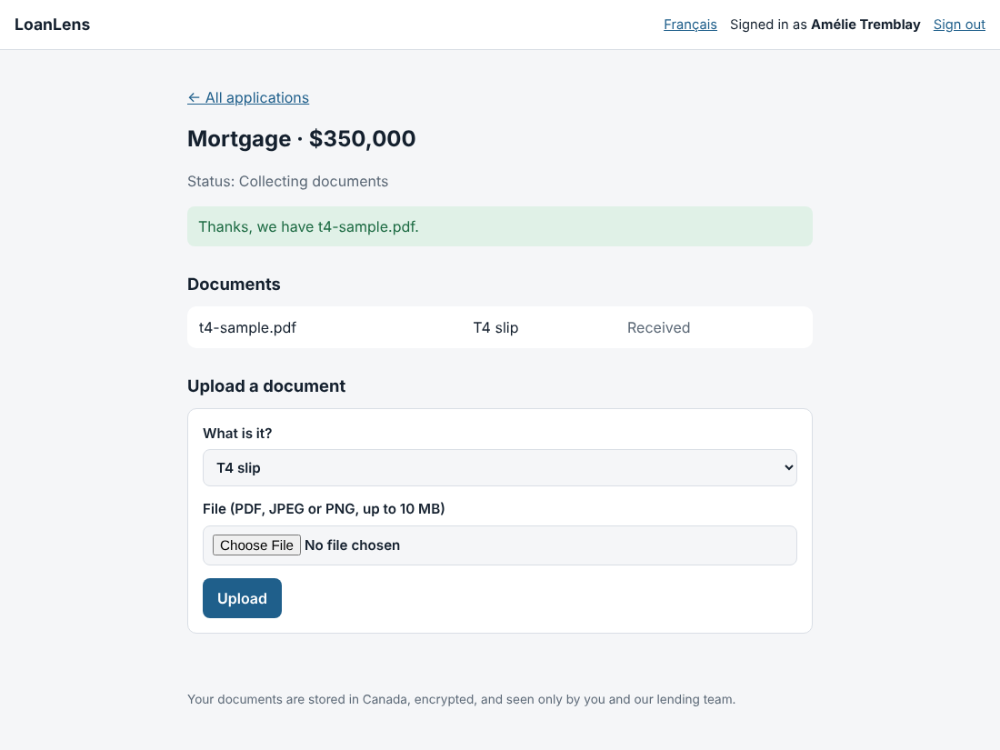
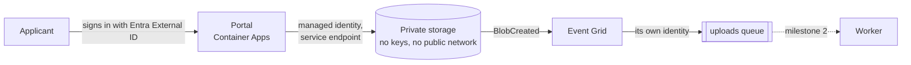
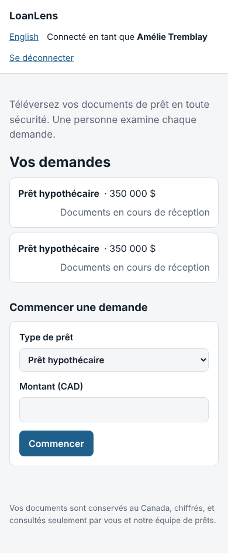
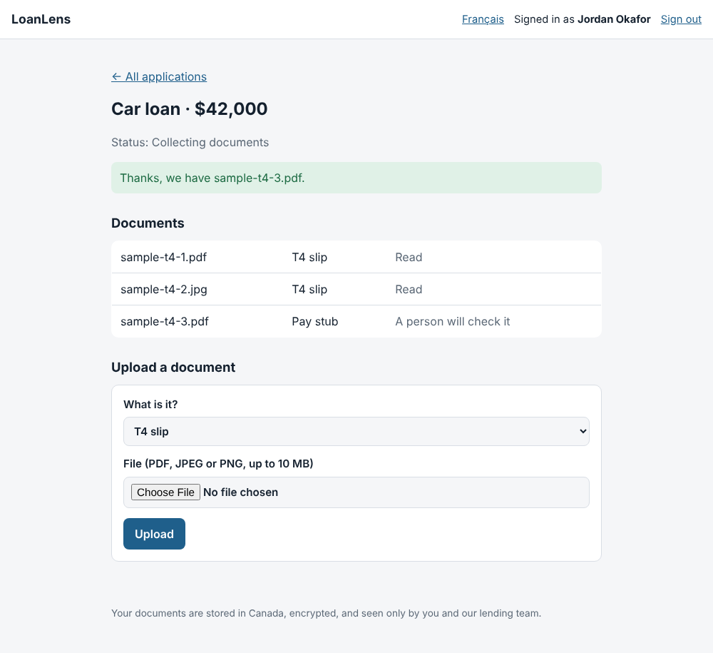
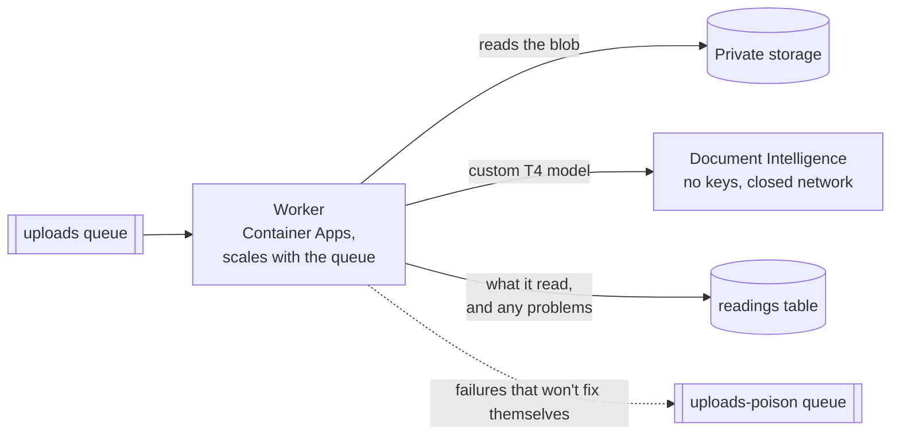
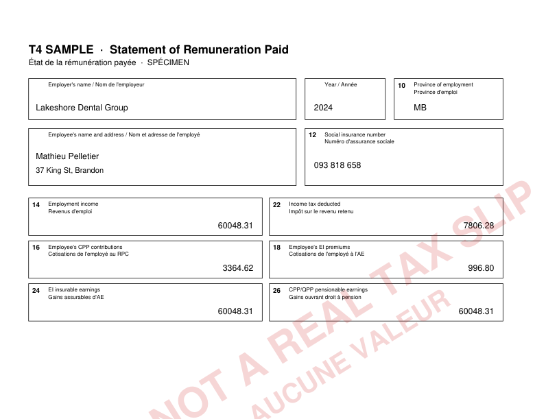

# LoanLens

**Loan documents uploaded securely, read by a model, and checked by a person, on Azure: a private upload
portal, a custom Document Intelligence model for T4 slips, and an underwriter dashboard in English and
French.**

[](https://github.com/omdkpatel810-ops/azure-loanlens/actions/workflows/ci.yml)

> **Status: milestones 1 and 2 of 4 are built and tested offline.** The upload portal and the document
> worker run locally against Azurite, the Azure Storage emulator, with 112 Python tests at 100% coverage,
> and the Azure infrastructure has 16 Terraform tests against mocked providers. The model's accuracy can
> only be measured once it's trained in Azure, which waits on the subscription; the measured results will
> go here.

## The problem

A credit union's lending team asks applicants to email their T4 slips and pay stubs. The documents
arrive unencrypted, in inboxes nobody audits. Then someone retypes each T4's income, tax and deductions
into the lending system by hand. That takes days per application, and typos reach the decision.

LoanLens replaces the email and the typing:

1. **Applicants upload to a private portal** after signing in. Documents go straight into storage that
   has no keys and no public network access.
2. **A worker reads each document** with a model trained to find a T4's boxes, and checks what it found.
3. **An underwriter reviews every application**, with the extracted figures, the model's confidence, and
   a short summary in English or French. Nothing is decided without a person.

It deploys into [Guardrails](https://github.com/omdkpatel810-ops/azure-guardrails), so its resource
group comes with an owner, a budget and Guardrails' policies.

## Milestone 1: the secure upload portal





### Signing in

Applicants have accounts in a separate **Microsoft Entra External ID** tenant, never in the credit
union's staff directory. Container Apps' built-in sign-in handles the login before a request reaches the
portal, and passes the person in headers the platform sets and a browser can't forge. Only
`/healthz` is open without signing in.

The sign-in secret goes from Entra ID straight into a Container Apps secret. It rotates every 90 days and
each one lasts 120, so there's always a month of overlap.

### Storing documents

- **No keys.** Shared-key access is off on the storage account; everything signs in with Entra ID.
- **No open network.** The account refuses every address except LoanLens' own subnet (over a service
  endpoint) and the operator's, for Terraform.
- **Least privilege.** The portal's identity can write to the uploads container and two tables, and pull
  its image. It can't read the queues or touch anything else.
- **Nothing public, ever**, plus TLS 1.2, double encryption, versioning, and 30 days to undo a deletion.
- **A copy in Canada East** (read-access geo-redundant storage), for milestone 4's failover drill.
- **Kept seven years, then deleted**, moving to cheaper storage after a month. The retention period is a
  variable, because the right number is the credit union's to set.

### Checking uploads

Before anything is stored, the portal checks:

- **What the file really is**, from its first bytes. A renamed program is refused, whatever its name or
  the browser says. PDF, JPEG and PNG only.
- **Its size**, reading no more than the limit (10 MB) even when someone sends more.
- **Password protection.** A locked PDF can't be read by the model, so the applicant is asked for an
  unlocked copy.
- **Limits**: 5 open applications per applicant, 20 documents per application.

Applicants only ever see their own applications: anyone else's is a 404. Every form carries a token that
must match a cookie, so another site can't submit forms on an applicant's behalf. Every page is sent with
a strict content security policy and isn't cached.

### Upload events

Every new document becomes a `BlobCreated` event, which Event Grid delivers to the `uploads` queue with
its own managed identity, since the account has no keys. Messages last a week, so a worker outage loses
nothing; undeliverable events go to a dead-letter container. Locally there's no Event Grid, so the portal
queues the same event itself, and the worker can't tell the difference.

### In English and French



Every word on the portal is in both languages. It follows the browser's language and remembers a choice
made with the link at the top.

## Milestone 2: the worker reads documents





### Training data, without anyone's real tax slips

Nobody should hand real T4s to a portfolio project, so [`loanlens/samples.py`](loanlens/samples.py)
makes them up: invented people and employers, with figures that follow each year's rules (CPP, EI and
QPP contributions worked out from that year's maximums, and Quebec slips using QPP instead of CPP).



- **Plainly fake.** Every slip has a large SAMPLE watermark and a footer saying it wasn't issued by the
  CRA. Social Insurance Numbers start with 0, a digit the government never issues, and they're never
  labelled, so the model never learns to read them.
- **Varied, like real uploads.** Three fonts, three ways of printing amounts (`52340.00`, `52,340.00`,
  `52 340,00`), a shifting layout, optional boxes (16A, 44), and about a third rendered as tilted, noisy
  phone photos.
- **Labelled exactly.** The generator knows where it drew every word, so it writes Document Intelligence's
  label files itself, polygons included, even on the tilted photos. No hand labelling.

[`loanlens/train.py`](loanlens/train.py) uploads the training slips, runs Microsoft's layout model on
each, and builds a custom neural model. Document Intelligence reads the training folder with its own
managed identity, let through the storage firewall by a rule naming that one service.

### Reading, then checking

For each upload event, the [worker](loanlens/worker.py) reads a T4 with the custom model, normalizes
every value, and checks it ([`loanlens/t4.py`](loanlens/t4.py)):

- required fields present (year, employer, employee, province, income, tax);
- tax deducted no more than income;
- CPP, CPP2, QPP and EI contributions, insurable and pensionable earnings no more than **that year's legal
  maximums** (2024 and 2025);
- CPP for everyone but Quebec, QPP for Quebec only;
- the model at least 80% sure of every value it read.

Any problem sends the document to a person ("needs review"); otherwise it's "read". Pay stubs and other
documents always go to a person. Either way, an underwriter reviews every application (milestone 3).
LoanLens never reads or stores the Social Insurance Number: lending doesn't need it.

### When things go wrong

| What happens | What the worker does |
|---|---|
| Document Intelligence throttles or has an outage | Puts the document back in line; the message reappears in 5 minutes. After 5 tries, gives up. |
| The document can't be read (no T4 in it, a bad file) | Marks it failed for a person, and moves the message to the poison queue |
| An event for a file with no record (not uploaded through the portal) | Poison queue |
| The same event delivered twice (Event Grid delivers at least once) | Reads the document once |
| An unexpected error | Leaves the message to come back later, and keeps going |

### Measuring the model

[`loanlens/evaluate.py`](loanlens/evaluate.py) runs the model over 20 held-out slips it never trained on
and reports field accuracy, slips entirely right, PDFs and photos separately, and the number that matters
most: **silent errors**, slips with a wrong value that the checks would *not* have sent to a person.

### Running it on your computer

`docker compose up` starts the worker too. Upload the sample slips in [`docs/samples/`](docs/samples/):
locally the worker uses a stand-in reader that knows the true values every LoanLens sample carries, so the
whole flow works without Azure. It reads only LoanLens' samples; anything else goes to a person.

## Running it

**On your computer**, with Docker:

```bash
docker compose up        # then open http://localhost:8000 and pick a sample applicant
```

Azurite stands in for Azure Storage and a local sign-in page stands in for External ID. Without Docker:

```bash
pip install -r requirements.txt
npx azurite --inMemoryPersistence --skipApiVersionCheck &
LOANLENS_AUTH=dev uvicorn --factory loanlens.portal:from_env
```

**In Azure**, once Guardrails has vended the resource group (the request is below):

1. Create a Microsoft Entra External ID tenant and a sign-up and sign-in user flow. This is done once,
   by hand; Terraform can't create the tenant.
2. Apply the infrastructure with a placeholder image, then push the real one and apply again:

   ```bash
   terraform -chdir=infra init -backend-config=...   # Guardrails' state storage
   terraform -chdir=infra apply -var customer_tenant_id=... -var customer_tenant_subdomain=... \
     -var 'operator_ip_ranges=["'"$(curl -s https://ifconfig.me)"'/32"]'
   az acr build -r "$(terraform -chdir=infra output -raw registry)" -t loanlens:$(git rev-parse --short HEAD) .
   terraform -chdir=infra apply -var image_tag=$(git rev-parse --short HEAD) ...
   ```

3. Add the app "LoanLens applicant portal" to the user flow in the External ID tenant.
4. Generate the samples, train the model, and measure it on the test slips:

   ```bash
   python -m loanlens.samples --out data/t4                      # 40 training and 20 test slips
   python -m loanlens.train data/t4/train --account "$(terraform -chdir=infra output -raw storage_account)" \
     --endpoint "$(terraform -chdir=infra output -raw document_intelligence)" --model-id loanlens-t4-v1
   python -m loanlens.evaluate data/t4/test --endpoint ... --model loanlens-t4-v1 --save results/accuracy.json
   ```

LoanLens' environment request for Guardrails (`environments/loanlens-prod.json` there):

```json
{"team": "loanlens", "environment": "prod", "owner": "lending-lead@example.com", "cost_center": "cc-7400",
 "region": "canadacentral", "monthly_budget": 60, "access": {"contributors": [], "readers": ["grp-guardrails-finance"]},
 "address_space": "10.100.6.0/24"}
```

**Cost.** Container Apps on the consumption plan scale to zero, so the portal costs nothing while nobody
is uploading, and the worker runs only while documents are waiting. The container registry (Basic) is
about $5 a month; storage and Event Grid cost cents at this volume. External ID is free for the first
50,000 applicants a month. Document Intelligence's
[free tier](https://azure.microsoft.com/pricing/details/ai-document-intelligence/) reads 500 pages a
month; after that it's charged per 1,000 pages. Training a neural model is free for the first 10 hours
and $3 an hour after that; training on 40 slips takes well under that.

## Tests

| What | How | Count |
|---|---|---|
| The portal: sign-in, applications, uploads, refusals, limits, who sees what, forged forms, French, security headers | pytest, with an in-memory store | 28 |
| File checks, upload events, settings, sign-in roles | pytest | 18 |
| T4 checks: amounts as printed, each year's maximums, Quebec rules, missing fields | pytest | 26 |
| The sample generator: marked as samples, figures that follow the rules, labels that point at the printed words | pytest, reading the PDFs back | 9 |
| The worker: clean reads, misreads, unsure model, retries then poison, duplicates, stray events, errors | pytest, with stand-in extractors | 11 |
| Document Intelligence calls, which failures are retried, the accuracy measurement (silent errors), training | pytest, with a stand-in client | 11 |
| The Azure Storage code end to end: tables, private blobs, events, the worker taking real queue messages | pytest, against Azurite | 9 |
| Python coverage | pytest-cov | 100% |
| Storage lock-down, retention, upload events, least privilege, scale to zero, sign-in, secret rotation, bad inputs | `terraform test`, mocked providers | 11 |
| Document Intelligence's lock-down, the worker's rights, scaling on the queue, no ingress | `terraform test`, mocked providers | 5 |
| Formatting, validation, linting, security scanning; the image builds and answers its health check | `terraform fmt` and `validate`, tflint, Checkov, ruff, Docker | every push |

Checkov passes 27 checks on the Terraform and skips 23, each with its reason written next to it (most are
Premium-only registry features). It passes every check on the workflow and the Dockerfile.

## Roadmap

1. **Secure upload portal**: applicant sign-in, private storage, upload events into a queue ✅ built and tested offline
2. **Worker reads documents**: a custom extraction model trained on generated T4s ✅ built and tested offline
3. **Underwriter dashboard** with bilingual summaries and human review
4. **Load test, monitoring, cost per application**, and the Canada East failover drill

## Layout

```
loanlens/       the portal (FastAPI) and the worker; t4.py (fields and checks), samples.py, train.py, evaluate.py
infra/          Terraform: network, private storage and Event Grid, Container Apps, External ID sign-in, Document Intelligence
docs/samples/   three generated sample T4s to try the portal with
tests/          Python tests (and infra/tests/ for Terraform)
docs/           screenshots
```
